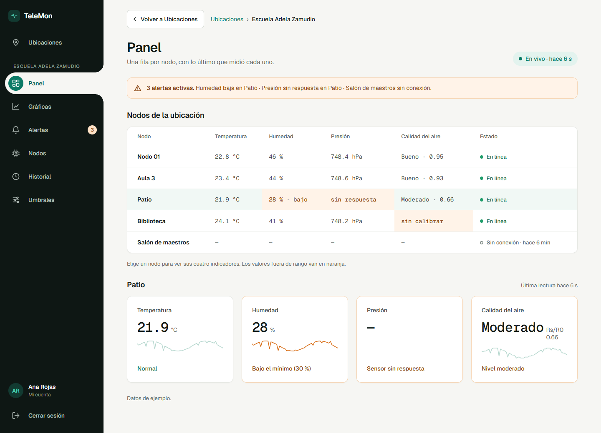
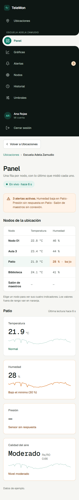
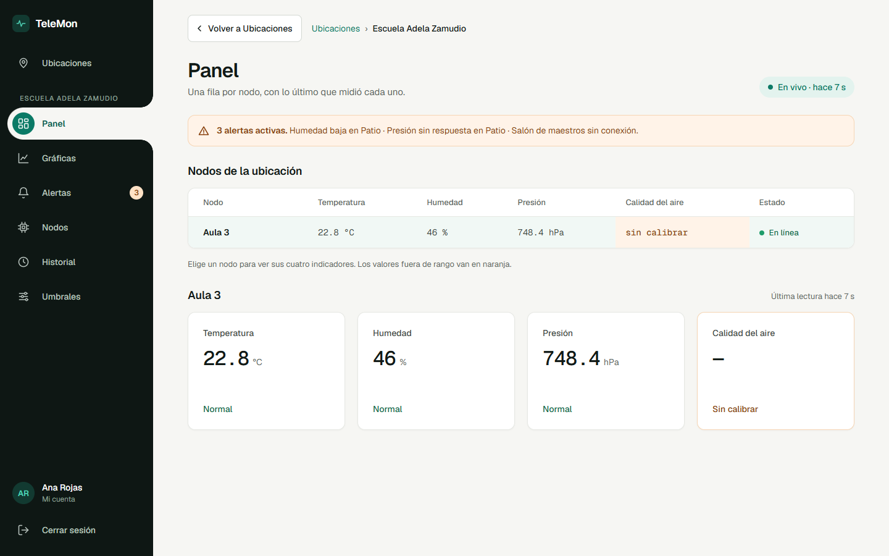

# #55 — Panel por nodo en vivo

PR #105. Archivos: `frontend/src/paginas/cliente/Panel.jsx`, `Panel.module.css` y `Panel.test.jsx`. Referencia: pantalla «3 · Panel» del mockup corregido.

## Figuras

**Figura 1.** Panel en modo demo, escritorio (1440 px), con «Patio» elegido como en el mockup.



**Figura 2.** Panel en modo demo, celular (390 px). La tabla se desplaza dentro de su tarjeta y las tarjetas pasan a una columna.



**Figura 3.** Panel con el backend real (Node-RED + PostgreSQL). «Aula 3» es el monitor de prueba de la base. La banda de alertas todavía sale de los datos de ejemplo (ver «Pendiente»).



## CP-04. La fila cambia sin recargar

Con `VITE_MODO_DEMO=false`, se abrió el Panel de la ubicación 1 y, unos segundos después, se publicó por MQTT una lectura con temperatura 25.55 y humedad 25. Contenido de la página leído desde el navegador, sin recargar:

| Momento | Pastilla | Fila de «Aula 3» |
|---|---|---|
| A los 3 s, antes de publicar | `En vivo · hace 22 min` | `— · — · — · — · Sin conexión · hace 22 min` |
| A los 8 s, después de publicar | `En vivo · hace 2 s` | `25.6 °C · 25 % · bajo · 748.4 hPa · sin calibrar · En línea` |

La humedad sale «bajo» porque 25 es menor que el mínimo de 30 %. La calidad del aire sale «sin calibrar» porque el monitor no tiene R0.

## Modo demo

Leído desde el navegador a los 3 y 8 s de abrir el Panel. Los valores se mueven poco a poco con cada evento simulado (cada 5 s), y los nodos con problemas siguen igual:

```text
3 s  Nodo 01 | 22.8 °C | 46 % | 748.4 hPa | Bueno · 0.95 | En línea
8 s  Nodo 01 | 23.1 °C | 47 % | 748.6 hPa | Bueno · 0.97 | En línea
     Patio   | 21.9 °C | 28 % · bajo | sin respuesta | Moderado · 0.66 | En línea
     Salón de maestros | — | — | — | — | Sin conexión · hace 6 min
```

## Pruebas automáticas

`Panel.test.jsx`, todas pasan:

- muestra una fila por nodo con sus valores, el canal en vivo y las alertas activas;
- resalta lo fuera de rango y distingue sensor sin respuesta, sin calibrar y sin conexión;
- muestra los cuatro indicadores del nodo elegido;
- actualiza solo la fila del nodo que envió la lectura (ignora lecturas viejas y de otra ubicación);
- pasa de esperar la primera lectura a en línea cuando llega;
- avisa si la ubicación no tiene nodos;
- muestra el error sin inventar filas si falla la consulta;
- indica cuando el canal en vivo está caído.

Suite completa del frontend: **22 archivos, 118 pruebas, todas pasan**. `npm run lint` y `npm run build` también pasan.

## Pendiente

- Con el backend real, la banda de alertas, los umbrales y las mini gráficas usan datos de ejemplo hasta que existan sus API (#72 y #73). Por eso en la figura 3 la banda nombra nodos que no están en la tabla y las mini gráficas salen vacías.
- El intervalo de refresco elegido en Nodos (#77) todavía no se aplica en el Panel; se coordina con Mantilla.
- Las gráficas demo tienen picos por un error en `frontend/src/api/demo/graficas.js` (`i / 6 + id` junta texto en vez de sumar). Ese archivo es de la pantalla Gráficas.
